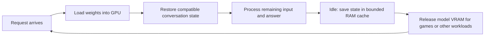

# MoE Expert LRU Cache + Pinned Host Vision (CUDA_Host) for llama.cpp

## Local inference that shares your GPU

Use the model for chat, coding and images; let it rest while you play a game, render a video or run another model. On the tested laptop, idle sleep releases almost all model VRAM while retaining a bounded conversation cache in system RAM. The next request reloads the weights and can restore compatible work already done, avoiding a full history replay when a usable state is still available.

### Features at a glance

| Feature | What it does | Thanks / reference |
| --- | --- | --- |
| **Expert LRU cache** | Keeps recently used MoE experts in a bounded VRAM budget, reducing repeated host-memory access/transfers. Newer upstream uses SLRU. | [csantiago78, PR #27861](https://github.com/ggml-org/llama.cpp/pull/27861); [eapache, SLRU #30637](https://github.com/ggml-org/llama.cpp/pull/30637) |
| **Pinned vision, GPU compute** | Keeps immutable vision weights in pinned RAM and stages tensors for CUDA execution, leaving more persistent VRAM for experts and context. | [GGML CUDA](https://github.com/ggml-org/llama.cpp/tree/master/ggml/src/ggml-cuda), [mtmd](https://github.com/ggml-org/llama.cpp/tree/master/tools/mtmd), and this project's vision work |
| **Optional expert DMA registration** | Registers expert host pages for direct DMA transfers. Useful on suitable hosts; the shared laptop leaves this off to preserve reclaimable RAM. | [NVIDIA CUDA host-memory APIs](https://docs.nvidia.com/cuda/cuda-runtime-api/group__CUDART__MEMORY.html), FreeToken and ncpumoe inspiration |
| **Reusable conversation cache** | Saves KV and recurrent state in bounded RAM, allowing compatible conversations to be restored between requests. | [ggerganov and contributors, host prompt cache #16391](https://github.com/ggml-org/llama.cpp/pull/16391) |
| **APEX-inspired checkpoints** | Retains intermediate recovery points so edited history can restart before the change. Our four-checkpoint adaptation is experimental. | [VectorAnvil/APEX V2](https://github.com/VectorAnvil/apex-r9700/blob/main/v2/reports/cache-coverage.md) |
| **Idle sleep + cached return** | Releases model VRAM after inactivity and preserves compatible prompt states in RAM through same-process sleep/wake. | [llama-server native sleep](https://github.com/ggml-org/llama.cpp/tree/master/tools/server) plus our cache-preservation integration |



**They solve different parts of the same workflow:** expert caching and pinned vision make active inference fit; prompt caching and checkpoints retain reusable calculations; sleep gives the GPU back between uses. Returning still includes weight reload, and reuse depends on an unchanged prefix and retained state.

> **October 19, 2026 status:** the sleep/cache integration and APEX-inspired candidate were built and exercised locally on base `620d2225`. This documentation update does not add those new patch files to the historical root bundle. A separate refresh against upstream `0ce8cd114` is prepared locally but remains unbuilt and unpublished; its newer SLRU has not inherited our older benchmark results.

[Measured before/after results and tested configuration](#october-2026-tested-configuration-and-benchmarks) · [How the features work together](#how-the-new-features-help-in-daily-use) · [Historical patch walkthrough](TECHNICAL_WALKTHROUGH.md)

---

## Historical September 2026 setup

The original description, benchmark tables and commands below are preserved. They describe the older **122B / RTX 5060 Ti** setup and legacy flags, separately from the **35B laptop** measurements added later. Historical “zero-copy” terminology refers to host registration: PCIe transfers and temporary GPU staging still exist in the current vision path. The shared laptop deliberately keeps expert banks pageable.


Running **122B Parameter MoE Models** (e.g., Qwen 3.8 Flash Next 122B) with **138k to 256k Context** and **Multimodal Vision** on a single **16GB Consumer GPU** (NVIDIA RTX 5060 Ti) at **up to 15.16 tokens/sec**.

---

> 🚀 **Update (Sept 2026): Zero-Copy PCIe DMA & 256k Ultra-Context Unlocked!**  
> • **Direct Zero-Copy DMA (`cudaHostRegister`)**: Eliminates Linux kernel staging copies for expert weights in host RAM. Cold generation speed boosted by **+50.5%** (8.44 ➔ **12.70 t/s**), and warm generation breaks the 15 t/s barrier at **15.16 t/s**!  
> • **256k Ultra-Context Mode**: Run a massive 256,000 token context window (4.6 GB KV cache) within 16GB VRAM at **12.20 t/s**!

---

## 🌟 Overview & Attribution

This project combines and refines three key architectural ideas to break the memory wall for Mixture-of-Experts (MoE) and Vision-Language models on consumer GPUs:

1. **MoE Expert LRU Cache (`--moe-expert-cache`)**:
   * Inspired by and building upon **PR #27861** on `llama.cpp` (`exp/moe-lru-cache`), with conceptual roots in **FreeToken**, dynamic expert offloading, and the evolutionary principles of **ncpumoe**.
   * Maintains a dynamic, device-resident LRU cache of the most recently and frequently used expert weights directly in GPU VRAM (e.g. 144 slots per layer). Uncached experts are evaluated on host memory or uploaded asynchronously via PCIe DMA, while cached experts compute at full GPU speed.
2. **Pinned Host Vision (`CUDA_Host` for Discrete GPUs)**:
   * Enables `CUDA_Host` (pinned system RAM via `cudaMallocHost`) support for discrete GPUs in `ggml-cuda.cu`.
   * When `MTMD_PINNED_HOST=1` is set, the multimodal vision projector (`mmproj`, ~866 MB in BF16) is allocated in host pinned RAM instead of persistent VRAM.
   * CUDA kernels execute the vision forward pass directly from pinned RAM over PCIe via DMA under demand, completely freeing ~866 MB of persistent VRAM for LLM experts and KV cache.
3. **Direct Zero-Copy PCIe DMA for Host Experts (`cudaHostRegister`)**:
   * Registers the 512 host-resident expert buffers with `cudaHostRegister` at model initialization.
   * Combined with `ulimit -l unlimited`, this locks physical RAM pages and enables true hardware DMA at full PCIe 3.0 bandwidth (15.7 GB/s), slashing expert upload latency and eliminating cold-start stuttering.

### 🙏 Credits & Acknowledgements
* **[llama.cpp](https://github.com/ggml-org/llama.cpp)**: Georgi Gerganov and the GGML team for the extraordinary foundational runtime that powers local LLM inference across heterogeneous hardware.
* **MoE Expert Cache PR (#27861)**: Authors of the host-offloaded GPU-resident LRU cache implementation (`exp/moe-lru-cache`), introducing dynamic slot caching and throttled asynchronous uploads.
* **FreeToken & ncpumoe**: Prior theoretical and empirical works demonstrating temporal locality, expert stickiness, and sparse activation patterns in modern MoE architectures, paving the way for hierarchical CPU/GPU memory routing.
* **Qwen Team (Alibaba Cloud)**: For developing the exceptional Qwen 3.8 Flash Next MoE architecture (512 total experts, 10 routed, 2 KV heads) which enables massive context windows with minimal KV memory footprint.
* **ISTA-DASLab**: For the GSQ-RCO quantization methodology and the N-gram speculative lookup tables that make 122B inference viable on consumer workstations.

---

## 🎯 The Core Synergy: Why Combine Both?

On a 16GB GPU (such as the RTX 5060 Ti with 15.6 GB usable VRAM):

* A 122B model with 512 experts (10 routed per token) requires ~3.7 GB for base dense/attention layers.
* A 138k token context window with `Q5_1` KV cache + Flash Attention 2 requires ~2.5 GB VRAM.
* A 120-slot MoE cache requires ~7.5 GB VRAM.
* **The bottleneck:** If the 866 MB vision projector is permanently pinned in VRAM, expanding the MoE cache to **144 slots (+50% capacity)** pushes VRAM requirements to **16.3 GB**, triggering an immediate **CUDA Out of Memory (OOM)** error.
* **The solution:** By offloading `mmproj` to `CUDA_Host` pinned RAM, the GPU reclaims ~866 MB of VRAM. This unlocked slot headroom allows allocating **144 MoE cache slots**, perfectly fitting within **15.2-15.5 GB VRAM** with **zero OOM** and **zero performance penalty for vision**.

---

## 📊 Benchmark & Real-World Validation

### Test Environment
* **CPU**: AMD Ryzen 7 5700G (8 cores / 16 threads, Zen 3, 3.8 GHz base / 4.6 GHz boost)
* **Motherboard & Bus**: Gigabyte A520M DS3H V2 running **PCIe 3.0 x16** (Ryzen 5700G APU hardware limitation)
* **Host RAM**: 48 GB DDR4 (4 sticks in Dual-Channel configuration @ 3200 MHz, 2x16GB + 2x8GB)
* **GPU**: NVIDIA GeForce RTX 5060 Ti 16GB (Blackwell Architecture, SM 12.0, 16,311 MiB VRAM)
* **Storage**: Fast NVMe PCIe M.2 SSD (Shard 2 N-gram speculative table memory-mapped via `-lm mmap`)
* **OS / Environment**: Linux x86_64, CUDA 13.1, NVIDIA Driver 590.48.01
* **Model**: `Qwen3.8-Flash-Next-GSQ-RCO-GGUF` (Q2_0, 122B total parameters, 512 experts, 10 routed per token)

> [!NOTE]
> **PCIe 3.0 Real-World Validation**: All benchmarks were achieved on a **PCIe 3.0** bus (limited by the Ryzen 5700G architecture). This demonstrates that this 3-tier offloading architecture does **NOT** require expensive PCIe 4.0/5.0 motherboards to deliver high generation speeds (~15 tokens/sec) for 122B models!

### Comprehensive Benchmark Comparison

| Configuration Profile | MoE Cache Slots | Context Window | VRAM Usage | Cold Generation (1st Req.) | Warm Generation (Sustained) | Status |
| :--- | :---: | :---: | :---: | :---: | :---: | :---: |
| Baseline (PR #27861) | 96 slots | 138k (`q5_1`) | ~13.6 GB | 7.8 t/s | 11.5 t/s | Baseline |
| +25% Experts (Default mmproj) | 120 slots | 138k (`q5_1`) | ~15.1 GB | 8.1 t/s | 10.4 t/s | Stable |
| +50% Experts (Default mmproj) | 144 slots | 138k (`q5_1`) | > 16.3 GB | — | — | ❌ **OOM** (+865 MB over limit) |
| **+50% Experts + Pinned Vision** | 144 slots | 138k (`q5_1`) | ~15.2 GB | 8.44 t/s | 14.87 t/s | Stable |
| **🔥 High-Throughput (Pinned Vision + Zero-Copy DMA)** | **144 slots** | **138k (`q5_1`)** | **~15.5 GB** | **12.70 t/s** (🚀 **+50.5%**) | **15.16 t/s** (⚡ **65.9 ms/tok**) | 🏆 **Optimal Default** |
| **🌌 Ultra-Context Mode (Zero-Copy DMA)** | **110 slots** | **256,000 (`q5_1`)** | **~15.2 GB** (KV: 4.6 GB) | **9.60 t/s** | **12.20 t/s** | 🚀 **256k Tokens in 16GB!** |

### Multimodal Vision Test (Real-world 400x300 Image)
* **Prompt Processing (including image encoding)**: **11.7 tokens/s**
* **Generation**: **10.9 tokens/s**
* **Recognition**: Accurately recognized complex architecture (*"interior of a modern church with basalt columns and concentric arches, Hallgrímskirkja..."*).

---

## 🛠️ Quick Start & Build Instructions

### 1. System Setup (Linux Memlock for Zero-Copy DMA)
To allow CUDA to lock physical host RAM pages for zero-copy DMA without memory staging copies:
```bash
sudo bash -c 'cat <<EOF > /etc/security/limits.d/99-cuda-memlock.conf
* soft memlock unlimited
* hard memlock unlimited
EOF'
```
*(Log out and log back in, or run `ulimit -l unlimited` in your active shell).*

### 2. Apply the Unified Patch
Clone a clean copy of `llama.cpp` and apply [`moe_lru_cache_and_pinned_vision.patch`](moe_lru_cache_and_pinned_vision.patch):

```bash
git clone https://github.com/ggml-org/llama.cpp.git
cd llama.cpp
git apply /path/to/moe_lru_cache_and_pinned_vision.patch
```

### 3. Build with CUDA Support
```bash
cmake -B build -DGGML_CUDA=ON -DCMAKE_BUILD_TYPE=Release
cmake --build build -j --target llama-cli llama-server
```

### 4. Run Inference (Choose Your Profile)

#### 🔥 Profile 1: High-Throughput (Default - 15.16 tokens/s)
Best for general chat, coding, and fast reasoning with 138k context:
```bash
MTMD_PINNED_HOST=1 nice -n 19 ./build/bin/llama-cli \
  -m /path/to/Qwen3.8-Flash-Next-GSQ-RCO-Q2_0-00001-of-00002.gguf \
  --mmproj /path/to/mmproj-Qwen3.8-Flash-Next-BF16.gguf \
  --image /path/to/sample.jpg \
  -ngl 999 -cmoe -fa on \
  --moe-expert-cache 144 \
  --moe-expert-cache-inserts 3 \
  -c 138000 -ctk q5_1 -ctv q5_1 \
  -t 8 \
  -p "Describe what you see in this image." \
  -n 128 --temp 0.7 -st
```

#### 🌌 Profile 2: Ultra-Context (256k Tokens - 12.20 tokens/s)
Best for whole-repository analysis, massive document ingestion, and book-length context:
```bash
MTMD_PINNED_HOST=1 nice -n 19 ./build/bin/llama-cli \
  -m /path/to/Qwen3.8-Flash-Next-GSQ-RCO-Q2_0-00001-of-00002.gguf \
  --mmproj /path/to/mmproj-Qwen3.8-Flash-Next-BF16.gguf \
  -ngl 999 -cmoe -fa on \
  --moe-expert-cache 110 \
  --moe-expert-cache-inserts 3 \
  -c 256000 -ctk q5_1 -ctv q5_1 \
  -t 8 \
  -p "Analyze this 200k token document..." \
  -n 128 --temp 0.7 -st
```

### 5. Run as an OpenAI-Compatible Server
```bash
MTMD_PINNED_HOST=1 nice -n 19 ./build/bin/llama-server \
  -m /path/to/Qwen3.8-Flash-Next-GSQ-RCO-Q2_0-00001-of-00002.gguf \
  --mmproj /path/to/mmproj-Qwen3.8-Flash-Next-BF16.gguf \
  -ngl 999 -cmoe -fa on \
  --moe-expert-cache 144 \
  --moe-expert-cache-inserts 3 \
  -c 138000 -ctk q5_1 -ctv q5_1 \
  -t 8 \
  --host 0.0.0.0 --port 8080 \
  -a qwen3.8-122b \
  --jinja -np 1 --temp 0.7 --top-p 0.95
```

---

## How the new features help in daily use

### 1. Expert caching: spend VRAM on the experts actually being used

MoE models activate only a fraction of their expert weights per token. Keeping useful experts in a bounded GPU cache avoids repeatedly fetching the same weights from slower host memory. The laptop reserves **3,712 MiB** for this expert cache (3,709.1 MiB reported after allocation), separate from its conversation cache. A larger cache trades more VRAM for fewer misses; its benefit depends on the workload and available PCIe/RAM bandwidth.

The original slot-based implementation is credited above. Our prepared newer-upstream source retains the native MiB-budgeted **50/50 SLRU** from PR #30637 rather than reinstalling the historical LRU implementation. That newer source still needs its own build and measurements.

### 2. Selective pinned vision: retain images without reserving all vision weights in VRAM

The current local path holds immutable projector weights in pinned host RAM and copies the tensors needed for execution to temporary GPU buffers. Vision computation stays on CUDA; persistent VRAM is freed for experts and KV. Transfers, synchronization and temporary allocations have a cost, so the old measurements are not a universal zero-overhead guarantee.

On the shared laptop, `ORNITH_MMPROJ_HOST_WEIGHTS=1` selects this path and `GGML_CUDA_NO_PINNED=1` keeps ordinary host allocations pageable. These are the newer local interfaces; the historical commands earlier in this README use `MTMD_PINNED_HOST` on their older patch.

### 3. Optional expert DMA: a different choice for a dedicated host

`cudaHostRegister` can remove an extra pageable-host staging step before a transfer, but it still transfers data over PCIe. Registering large expert banks also prevents those pages from being reclaimed or swapped until released. On Linux, this reduces the RAM available to applications and to swap/zram management of other pageable allocations; it does not disable Linux memory management globally.

For a shared laptop, the chosen policy is **pageable/mmap expert banks, selective vision pinning, a bounded expert GPU cache and idle sleep**. Leave `GGML_CUDA_REGISTER_HOST` unset: this optional path checks presence, so setting it to the string `0` still enables registration. The historical dedicated-host DMA results remain below for comparison.

### 4. Conversation cache: keep prior calculations across requests

The **3,072 MiB RAM prompt-cache budget** stores complete conversation states, including their saved recurrent checkpoints. It grows with use and is shared by clients using this backend; it is not another expert cache. Matching is based on token prefixes, not on which application or chat name sent the request. The active context, its checkpoints, model mappings and transient copies can occupy memory outside this payload quota.

For the current 35B Q8/Q8 geometry, a fully occupied 102,400-token entry is estimated at **about 1.34 GiB plus metadata**: 1,062.5 MiB KV, 62.8 MiB final recurrent state and four 62.8 MiB checkpoints. About two such entries could fit in 3 GiB; this is a sizing estimate, not a filled-100K sleep test. The four intermediate snapshots do not each duplicate the full KV. On eviction the pool removes whole entries, not independently protected prefix fragments.

### 5. APEX-inspired checkpoints: recover before an edited part of history

A recurrent state cannot simply be rewound to any earlier token. If history changes before every available snapshot, the server may have to replay the full prompt even though much of its beginning is identical. Inspired by VectorAnvil/APEX V2, our adaptation targets checkpoints near **one-third and two-thirds** of the prompt at existing natural batch boundaries, retaining two interior anchors and the two latest states within the existing four-checkpoint cap.

The local gate is `ORNITH_CHECKPOINT_GRID=1`. Eligibility is text-only, one slot, four checkpoints, no SWA, LoRA, speculation or cache-reuse shifting; media uses the prior path. The adaptation preserves state validation and existing batch/microbatch geometry. It does not import APEX's AMD kernels or its entire batching implementation. A static agent prefix, such as 25K tokens, has no separately protected checkpoint today: a snapshot must still exist before the first changed token. Very early edits or evicted entries can require full replay.

This remains an **experimental local adaptation**. Six main short fixtures matched generated IDs and reported top-10 logprobs, but a strict boundary-prefix test failed complete token equality. Follow-up tests reproduced later-token variation with the feature disabled too; a fresh grid-prefix case still diverged later. Structured-chat cold/repeat comparisons matched. These checks do not establish universal numerical parity or full-context quality.

### 6. Idle sleep and return: hand the GPU back without discarding every conversation

The local supervisor enters native sleep after **20 minutes without inference**. Before releasing model, vision and GPU KV resources, the integration saves idle slot state into the RAM prompt cache. On wake it keeps that cache only when model/projector identity and context/cache configuration remain compatible. Metadata/health requests do not wake the model, and the model's weights are reloaded when inference resumes.

This preserves state within the **same running process**. Stopping the process or rebooting loses this RAM pool; a changed or evicted prefix can still need recomputation. The laptop's low-VRAM state leaves a small CUDA allocation behind and retains bounded, pageable prompt data in RAM, allowing other GPU applications to use the released capacity. It is not a promise of zero RAM usage or instantaneous wake.

## October 2026 tested configuration and benchmarks

### Configuration used for the laptop cache tests

| Setting | Tested value |
| --- | --- |
| GPU / host memory | RTX 3070 Ti Laptop GPU, 7,842 MiB reported VRAM; 32 GB-class system RAM |
| Main model | Ornith 1.5 35B A3B, GGUF Q4_K_M |
| Built source base | `620d2225cc436ab0b001e3200e590e3b286ef9ab` plus local LRU, vision and sleep/cache changes; grid added for its A/B |
| Configured context / active slots | 102,400 tokens / 1 |
| KV / batch / microbatch | Q8_0 K and V / 512 / 128 |
| Expert cache / saved conversation pool | 3,712 MiB VRAM / 3,072 MiB RAM |
| Recurrent checkpoints / idle sleep | 4 / 1,200 seconds |
| Host policy | Vision weights pinned; expert weights pageable/mmap; expert registration off |
| Speculation | MTP and DFlash disabled in this profile |

**Method:** controlled synthetic prompts with greedy generation; no generated code was executed. The 102,400-token value is configured capacity, not the tested prompt length. Sleep fixtures had 516 tokens and one output token; the grid A/B started with 2,304 input tokens and short outputs. Measurements below are single controlled runs or the two listed wake cycles, not statistical throughput qualification. Compact numeric evidence is in [benchmarks/cache-return-20261019.json](benchmarks/cache-return-20261019.json).

### Cold start versus cached return after sleep

| Same text fixture A | Initial cold request | Return after sleep, cycle 1 | Return after sleep, cycle 2 |
| --- | ---: | ---: | ---: |
| Cached input tokens / total | 0 / 516 | 512 / 516 | 512 / 516 |
| Input tokens evaluated | 516 | 4 | 4 |
| Native prompt-processing time | 14.301 s | 0.650 s | 1.023 s |
| Total HTTP request wall time | 49.682 s | 23.870 s | 21.402 s |

The returns reused **99.22% of input tokens** and had **95.46% / 92.84% less reported prompt time** than this cold reference. These are **cold-start-versus-cached-wake observations**, not a matched sleep-preservation-OFF/ON experiment: initial load, OS page cache and warm-up differ. Wall time includes weight reload and request overhead; it is not streaming TTFT. A separate already-loaded cold fixture B took 4.763 s of prompt processing, illustrating why first-load and steady-state costs should stay separate.

| GPU handoff measurement | Loaded model | Native sleep | Released |
| --- | ---: | ---: | ---: |
| Process VRAM, sleep test | 6,952 MiB | 216 MiB | 6,736 MiB (96.89%) |

Two saved conversations occupied **387.611 MiB** during that small-fixture sleep test. A later grid test retained three states using **1,014.107 MiB** and slept at 232 MiB process VRAM. Actual cache occupancy depends on history length and checkpoints; the configured budget is not a fixed reservation.

### APEX-inspired recovery: same candidate, gate OFF versus ON

| Input case | Grid OFF prompt time | Grid ON prompt time | ON versus OFF |
| --- | ---: | ---: | ---: |
| First cold prompt | 24.947 s | 25.682 s | 2.95% longer |
| Edit around 85% of history | 15.761 s | 5.690 s | **63.90% less time** |
| Edit around 50% | 13.870 s | 8.143 s | **41.29% less time** |
| Edit around 20% | 14.106 s | 14.349 s | 1.72% longer; no reusable interior anchor |

The benefit is reduced **prompt processing before generation**, not a measured generation-TPS increase. The six main comparisons and the documented numerical limitations are summarized in the evidence JSON. A production-FIFO smoke restored 1,937 of 1,941 tokens and kept all five local serving/bridge services active. No full 100K suspension or arbitrary-history guarantee is claimed.

### Expert cache and DMA gains: historical dedicated-host results

The original September **122B / RTX 5060 Ti 16 GB / PCIe 3.0** table earlier in this README remains the source for these figures. It is a different model, host and runtime from the laptop above; the measurements were not rerun for this documentation update.

| Historical configuration comparison | Cold generation | Warm generation | Interpretation |
| --- | ---: | ---: | --- |
| 96-slot baseline → 144 slots + pinned vision | 7.80 → 8.44 tok/s (**+8.2%**) | 11.50 → 14.87 tok/s (**+29.3%**) | Joint profile change: more expert-cache capacity enabled by vision offload; not isolated LRU ON/OFF. |
| 144 slots + pinned vision → same profile + expert DMA | 8.44 → 12.70 tok/s (**+50.5%**) | 14.87 → 15.16 tok/s (**+2.0%**) | Host-registration comparison from the historical setup; registration remains off on the shared laptop. |

The historical full table also records the 144-slot default-projector OOM case and the separate 256K profile. There is no new matched LRU-disabled/SLRU-versus-LRU benchmark here; the prepared upstream SLRU must be measured independently. Thanks again to the upstream cache authors, GGML/llama.cpp, NVIDIA's memory primitives and VectorAnvil/APEX for the mechanisms and references that made these experiments possible.

---

## 📖 Deep-Dive Code Walkthrough

For an in-depth, line-by-line explanation of the patch and the mathematical properties of the exact sum (`ggml_add`), refer to [**`TECHNICAL_WALKTHROUGH.md`**](TECHNICAL_WALKTHROUGH.md).

---

## 📄 License
This work is released under the same license as `llama.cpp` (MIT License).
