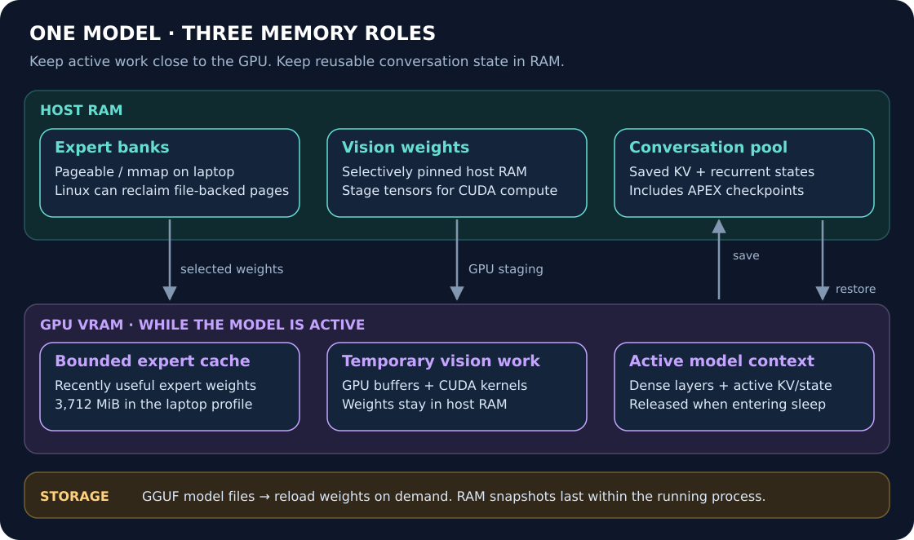
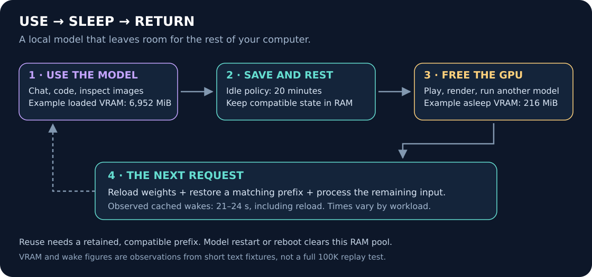
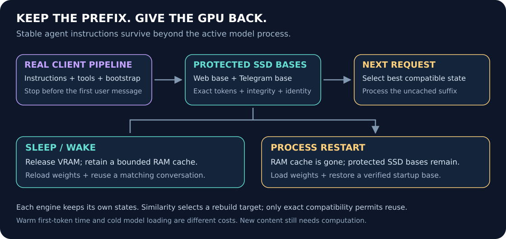
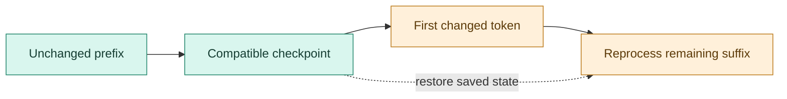

# 🧠 MoE LRU Cache + Pinned Vision + Persistent Context

**Run larger models locally, keep useful conversation state, and give the GPU back between uses.**

This project brings expert caching, selective vision offload and conversation-state reuse together in `llama.cpp`. Use the model for coding, chat or images; let it rest while you game, render or run another model; then reload the weights and resume from a compatible cached prefix. Protected startup checkpoints on SSD also preserve an agent's stable instructions and tools across process restarts.

> 🚀 **Measured highlights**<br>
> **122B on a 16 GB GPU:** up to **15.16 tok/s**, with a separate **256K** profile at **12.20 tok/s**.<br>
> **35B laptop:** **6,952 → 216 MiB** process VRAM during sleep; **99.22%** of a short fixture's input reused on return.<br>
> **APEX-inspired recovery:** up to **63.90% less prompt-processing time** in the tested edited-history cases.<br>
> **Ready agent prefixes:** **0.98–1.21 s** to the first token when switching interfaces on the loaded 35B laptop; separate Web and Telegram bases survive a complete serving-stack restart.

These figures come from two different test environments. The configurations, comparisons and limits are recorded in [Benchmarks & Validation](#benchmarks).

## 🌟 Overview & Attribution

Eight complementary features, each with a specific job:

| Feature | What it does | Foundation / attribution |
| :--- | :--- | :--- |
| **⚡ Expert LRU cache** | Keeps recently used MoE experts in a bounded VRAM budget, reducing repeated access to host-resident weights. | [csantiago78, PR #27861](https://github.com/ggml-org/llama.cpp/pull/27861); newer upstream [SLRU by eapache, #30637](https://github.com/ggml-org/llama.cpp/pull/30637) |
| **👁️ Pinned host vision** | Keeps vision weights in pinned RAM while CUDA performs image computation, leaving persistent VRAM for experts and context. | [GGML CUDA](https://github.com/ggml-org/llama.cpp/tree/master/ggml/src/ggml-cuda), [mtmd](https://github.com/ggml-org/llama.cpp/tree/master/tools/mtmd), and this project's vision adaptation |
| **🔌 Optional expert DMA** | Registers host expert pages for direct DMA transfers; an optional tradeoff for machines that can dedicate the RAM. | [NVIDIA CUDA memory APIs](https://docs.nvidia.com/cuda/cuda-runtime-api/group__CUDART__MEMORY.html) and expert-offloading work |
| **💬 Reusable conversation cache** | Saves KV and recurrent state in bounded host RAM so compatible conversations can be restored between requests. | [ggerganov and contributors, prompt caching #16391](https://github.com/ggml-org/llama.cpp/pull/16391) |
| **📍 APEX-inspired checkpoints** | Adds intermediate recovery points so an edited conversation can resume before its changed suffix. | [VectorAnvil/APEX V2 checkpoint research](https://github.com/VectorAnvil/apex-r9700/blob/main/v2/reports/cache-coverage.md); local experimental adaptation |
| **🌙 Idle sleep + cached return** | Releases model VRAM after inactivity and preserves compatible conversation state through same-process sleep/wake. | [llama-server native sleep](https://github.com/ggml-org/llama.cpp/tree/master/tools/server) plus our preservation integration |
| **💾 Protected startup checkpoints** | Keeps two verified pre-user prefixes on SSD; restores the compatible base without replaying all the stable instructions. | Our [native selection patch](patches/llama.cpp/) and [controller](integrations/llama_cpp/), built on llama-server state save/restore |
| **🧭 Cacheable agent preparation** | Indexes deferred capabilities and places static plugin instructions before the first user message, preserving on-demand skill loading. | [Hermes](https://github.com/NousResearch/hermes-agent), [Superpowers](https://github.com/obra/superpowers), and our [integration](integrations/hermes/) |

**Availability:** the original LRU/vision/DMA bundles remain available. The tested `620d2225` native patch now includes selective pinned vision, sleep-cache preservation, experimental checkpoint anchors and transactional prefix selection. Portable controllers and optional Hermes/Tabby integrations are published alongside it. Start with the [versioned integration guide](docs/PERSISTENT_PREFIXES.md); these are source-level integrations, not a universal installer. The separate latest-upstream refresh remains unqualified.

---

## 🎯 The Core Synergy: Fit, Remember, Release

Expert caching and pinned vision make active inference fit the GPU. Conversation caching keeps prior calculations reusable. Checkpoints provide earlier places to resume after a history change. Sleep releases the active GPU resources while keeping a bounded RAM pool available for the next request.



The caches hold different things: the **expert cache** stores model weights in VRAM; the **conversation cache** stores calculations from prior inputs in RAM. APEX changes where recovery points are retained inside a conversation. The **protected SSD bases** retain only the stable context before the first user message. They do not duplicate a whole conversation or create another RAM cache pool.

### 🎮 Use the model, then use the rest of your computer



The tested laptop rests after **20 minutes without inference**. Health/model-metadata queries do not wake it. The next inference reloads the model weights, restores a matching cached state when available, and evaluates the remaining input. Weight reload still takes time; cache reuse avoids repeating all of the prompt work when a usable state survives.



After a **process restart**, the ordinary RAM pool is gone. The protected initial bases remain on SSD. Each backend restores its own compatible states; no attention or recurrent state is shared between different models, quantizations or engines. The [new return benchmarks](docs/PREFIX_BENCHMARKS.md) separate weight loading, cache reuse, first-token time and complete response time.

---

## 🔍 How Each Improvement Helps

### ⚡ 1. Expert caching: keep useful weights close to the GPU

MoE models activate a small selection of experts per token. A bounded GPU cache retains recently useful expert weights, reducing repeated host-memory access or transfers. Its size trades VRAM against cache misses; performance depends on routing locality, RAM bandwidth, PCIe and the workload.

The original 122B setup uses the slot-based `--moe-expert-cache` interface. The later laptop runtime uses **`--moe-cache-mib 3712`**, allocating about **3,709.1 MiB**. The prepared upstream refresh keeps the native **50/50 SLRU** from PR #30637. That newer cache algorithm needs its own measurements; it does not inherit the older LRU speedups automatically.

### 👁️ 2. Pinned vision: retain images while making room for experts

Immutable vision-projector weights live in pinned host RAM. The current local path stages the tensors needed for execution into temporary GPU buffers and runs the vision work on CUDA. This saves persistent VRAM while retaining image support; PCIe transfers, synchronization and temporary VRAM remain part of the cost.

That headroom mattered in the original 16 GB setup: **144 expert-cache slots with the default projector exceeded 16.3 GB and failed**, while pinned vision allowed the 144-slot profile to fit at about **15.2 GB**. The reported projector size was roughly **866 MB**; the result is specific to that model and geometry.

The historical bundle uses `MTMD_PINNED_HOST=1`. The newer local laptop path uses `ORNITH_MMPROJ_HOST_WEIGHTS=1`, with `GGML_CUDA_NO_PINNED=1` for ordinary host allocations. Their interfaces belong to different patch generations.

### 🔌 3. Expert DMA: choose the host-memory policy for the machine

`cudaHostRegister` can remove an extra pageable-host staging step before an expert transfer. The historical project calls this **zero-copy DMA**; the data still crosses PCIe. Dedicated-host measurements showed a substantial cold-generation gain, recorded below.

Pinned pages cannot be reclaimed or swapped until released. Pinning large expert banks therefore reduces the RAM left for other applications and for Linux's reclaim/swap/zram mechanisms. The shared laptop keeps expert banks **pageable/mmap**, pins only the vision weights, and leaves expert registration off. This is a different choice from a workstation dedicated to inference.

For the optional local registration path, leave `GGML_CUDA_REGISTER_HOST` **unset** when disabled: it checks presence, so the string `0` also enables registration. Memlock setup and the older dedicated-host launch commands remain in the [original build guide](docs/LEGACY_122B_SETUP.md).

### 💬 4. Conversation caching: keep work already done

The laptop's **3,072 MiB RAM prompt-cache budget** stores complete conversation entries, including their KV, recurrent state and saved checkpoints. It grows with use. Clients of the same backend can reuse a compatible token prefix regardless of which app or chat sent it.

This quota covers stored payload, not the whole process. Active context/checkpoints, model mappings, metadata and transient copies can use additional RAM. When the pool fills, it evicts whole entries; it does not independently protect fragments of every conversation.

For this 35B Q8/Q8 geometry, a **102,400-token entry is estimated at about 1.34 GiB plus metadata**: 1,062.5 MiB KV, 62.8 MiB final recurrent state and four 62.8 MiB checkpoints. The intermediate snapshots do not each duplicate the full KV. Roughly two such entries could fit in 3 GiB; this is a sizing estimate, not a completed 100K sleep test.

### 📍 5. APEX-inspired checkpoints: recover before a history change

A recurrent state cannot be rewound to an arbitrary earlier token. If all saved snapshots come after the first change in the new input, the server may need to replay the prompt. Intermediate checkpoints give it earlier valid recovery points.

Our adaptation, inspired by VectorAnvil/APEX V2, targets natural batch boundaries near **one-third and two-thirds** of the prompt. It retains two interior anchors and the two latest snapshots within the existing **four-checkpoint cap**, preserving state validation and batch/microbatch geometry.



The local gate is `ORNITH_CHECKPOINT_GRID=1`: text only, one slot, four checkpoints, no SWA, LoRA, speculation or cache-reuse shifting. Media uses the prior path. We did not import APEX's AMD kernels or its complete batching implementation. These ordinary anchors remain evictable; the separate protected-prefix controller below provides persistent startup bases.

This remains **experimental**. Six main short fixtures matched generated IDs and reported top-10 logprobs. A strict boundary-prefix test failed full-token equality; follow-ups also found later-token variation with the feature disabled, while a fresh grid-prefix case still diverged later. Structured-chat comparisons matched. The [evidence JSON](benchmarks/cache-return-20261019.json) preserves those results; they do not establish universal numerical parity or full-context quality.

### 🌙 6. Idle sleep: release VRAM and keep a path back

Before native sleep releases model, vision and GPU KV resources, our integration saves idle slot state into the bounded RAM prompt cache. Wake retains that pool only when the model/projector identity and context/cache settings remain compatible.

The saved pool lasts within the **same running process**. Process shutdown or reboot clears that RAM pool. Protected SSD startup bases survive separately; the rest of a changed or evicted conversation can still require replay. Sleep retains some RAM and a small CUDA allocation, but releases almost all model VRAM in the tested laptop setup, leaving room for games, video tools or another model.

### 💾 7. Protected startup prefixes: remember the agent before its first question

Two independent SSD bases retain the native tokenized instructions and tool definitions for two client flows, such as Hermes Web and Telegram. The boundary is determined from the real rendered request, before any user content. A fixed greeting or synthetic answer is never part of the saved base.

```text
Web request ───────┐                  ┌─ active state: keep it if best
                  ├─ exact matching ─┼─ RAM conversation: restore if better
Telegram request ─┘                  └─ SSD startup base: verified fallback
                                              │
                                     evaluate the new suffix
```

Only exact native tokens and compatible model/runtime identity allow state reuse. If neither base matches, similarity chooses **which base to rebuild**, not which incompatible state to restore. A free slot is used first; the other occupied base remains intact. Integrity checks and per-base status distinguish a missing, invalid or changed base from a normal interface switch.

The native selector accounts for usable hybrid/recurrent checkpoints, preserves an advanced active conversation in the existing bounded RAM pool before replacing it, and avoids downgrading a warmer state to the shorter SSD base. Multimodal histories keep the native media path because a text preview cannot represent image/audio chunks correctly.

The tested limit is **2 GiB per SSD base, 4 GiB combined**, separate from the **3 GiB laptop RAM pool**. Atomic replacement may briefly need additional disk space. After a full serving-stack restart, the 27B backend imported both bases into RAM at startup; the lazy 35B backend verified both on disk and deferred weight loading and import until the next request. A full OS reboot was not part of that test.

### 🧭 8. Agent preparation: keep the useful prefix stable

Deferred tools have a compact capability catalog; the agent loads the detailed schema when needed. Skills continue to use their native loader. Static Superpowers bootstrap instructions now occupy bounded native system sections before the first user message, with the original text and skill files preserved. A compatibility hook retains the previous behavior for older frozen sessions or skipped sections.

Preparation uses the real interface factory, profile directory, memories, tool availability and provider/template options. Two fresh requests with different questions must produce the same protected prefix. This prevents a task-specific fixture, such as a Kanban prompt, from being mistaken for the ordinary chat baseline. Existing conversations retain their frozen prompts; a new session picks up the revised organization. See the [Hermes integration](integrations/hermes/) for the versioned patches and CPU-only checks.

---

<a id="benchmarks"></a>
<a id="october-2026-tested-configuration-and-benchmarks"></a>

## 📊 Benchmarks & Validation

Two environments are documented below. **Generation tok/s, prompt-processing time, total request time and released VRAM are different measurements.** The comparisons are kept with the hardware and configuration that produced them.

### 💻 A. 35B laptop — sleep, return and edited-history recovery

| Setting | Tested configuration |
| :--- | :--- |
| Hardware | RTX 3070 Ti Laptop GPU, 7,842 MiB reported VRAM; 32 GB-class system RAM |
| Model | Ornith 1.5 35B A3B, GGUF Q4_K_M |
| Built source | `620d2225cc436ab0b001e3200e590e3b286ef9ab` + local LRU/vision/cache changes; checkpoint grid added for its A/B |
| Context / slots | 102,400 tokens configured / 1 active slot |
| KV / batch / microbatch | Q8_0 K and V / 512 / 128 |
| Expert cache / conversation pool | 3,712 MiB VRAM / 3,072 MiB RAM |
| Recurrent checkpoints / idle timeout | 4 / 1,200 seconds |
| Host policy / speculation | Pinned vision, pageable/mmap experts, expert registration off / MTP and DFlash off |

#### 🌙 Cold request → cached return

| Same text fixture A | Initial cold request | After sleep · cycle 1 | After sleep · cycle 2 |
| :--- | ---: | ---: | ---: |
| Reused input / total tokens | 0 / 516 | **512 / 516** | **512 / 516** |
| Input tokens evaluated | 516 | **4** | **4** |
| Native prompt-processing time | 14.301 s | **0.650 s** | **1.023 s** |
| Total HTTP request wall time | 49.682 s | **23.870 s** | **21.402 s** |

Both returns reused **99.22%** of the input. Reported prompt time fell **95.46% / 92.84%** relative to this cold reference. These are observed cold-start-versus-cached-wake results, not a matched preservation-OFF/ON experiment: initial loading, OS page cache and warm-up differ. An already-loaded cold fixture B took **4.763 s** of prompt processing. Wall time includes reload and overhead; it is not streaming TTFT.

| Model VRAM | Loaded | Asleep | Released |
| :--- | ---: | ---: | ---: |
| Process measurement | 6,952 MiB | **216 MiB** | **6,736 MiB · 96.89%** |

Two short-fixture states occupied **387.611 MiB** during that sleep test. A later grid test retained three states using **1,014.107 MiB** and slept at **232 MiB** process VRAM. Cache occupancy varies with history and checkpoints; 3 GiB is a payload ceiling, not a fixed reservation.

#### 📍 APEX-inspired recovery · same candidate, gate OFF/ON

| Input case | Grid OFF prompt time | Grid ON prompt time | Difference |
| :--- | ---: | ---: | :--- |
| First cold prompt | 24.947 s | 25.682 s | 2.95% longer |
| Edit around 85% of history | 15.761 s | **5.690 s** | **63.90% less time** |
| Edit around 50% | 13.870 s | **8.143 s** | **41.29% less time** |
| Edit around 20% | 14.106 s | 14.349 s | 1.72% longer; no reusable interior anchor |

The gain is in **prompt processing before generation**, not a measured increase in generation tok/s. Early changes, absent snapshots and eviction can still require a full replay.

<details>
<summary><strong>🔬 Method, evidence and validation limits</strong></summary>

- Controlled synthetic prompts with greedy generation; generated code was never executed.
- Sleep fixtures: **516 input tokens, one output token**. Grid A/B: initial **2,304-token input**, short outputs. The 102,400-token value is configured capacity, not a filled-context benchmark.
- Two wake cycles and targeted grid comparisons; no statistical throughput qualification or full-100K sleep test.
- Six main grid comparisons matched output IDs and reported top-10 logprobs; strict edge failures and the follow-up divergence are retained, as described above.
- A real serving-FIFO smoke restored **1,937 / 1,941 tokens**, with five local serving/bridge services active.
- Compact measurements, source-receipt hashes and limitations: [cache-return-20261019.json](benchmarks/cache-return-20261019.json).

</details>

### 💾 B. Protected prefixes — real agent flows and restart

The new [return benchmark report](docs/PREFIX_BENCHMARKS.md) records both controlled requests and real user calls, including the complete serving-stack restart with **zero warm-up inference**. The companion [numeric evidence](benchmarks/persistent-prefix-return-20261020.json) retains the distinction between cold weight loading and loaded-model response latency.

| Loaded model, short controlled request | Web first token | Telegram first token |
| :--- | ---: | ---: |
| 35B laptop, switch back using RAM | **1.213 s** | **0.981 s** |
| 27B workstation, alternating fresh flows | **0.875 s** | **0.509 s** |

All ten controlled calls completed normally without tool execution. The two bases per backend remained available. These first-token figures include reasoning output and are not generation throughput or complete Hermes task durations. Reloading model weights after sleep or shutdown still costs time; the checkpoint removes repeated prefix evaluation, not model loading.

The first **real user requests after the complete restart**, without artificial warm-up:

| Environment | Cached / input tokens | Native first token | API / proxy request time |
| :--- | ---: | ---: | ---: |
| 35B laptop, weights loaded inside the request | **16,233 / 16,340 · 99.35%** | Not retained | **76.5 s**, including loading and restoration |
| 27B workstation, weights and SSD bases loaded at startup | **23,040 / 23,273 · 99.00%** | **0.97 s** | **4.133 s**, proxy service time |

The 27B proxy's first byte arrived at **2.710 s**. On the laptop, a valid prefix was reported **55.771 s** after request start, but that interval combines loading, readiness and restoration; it cannot be labeled pure weight-load time. The operator described continuation as feeling immediate after loading. That perception is kept separate from measured latency. The report includes the slower real calls too, including a 23,120-token new suffix on the 27B; new content still requires work.

### 🖥️ C. 122B workstation — expert cache, vision and DMA

The original September results remain part of the project: a **122B Q2_0 MoE**, **RTX 5060 Ti 16 GB** and **PCIe 3.0 x16**. These figures were not rerun for the October documentation update and are separate from the laptop results.

| Profile | Expert slots | Context | Reported VRAM | Cold generation | Warm generation | Result |
| :--- | ---: | :--- | :--- | ---: | ---: | :--- |
| Baseline, PR #27861 | 96 | 138K, Q5_1 | ~13.6 GB | 7.80 tok/s | 11.50 tok/s | Baseline |
| Default projector | 120 | 138K, Q5_1 | ~15.1 GB | 8.10 tok/s | 10.40 tok/s | Stable |
| Default projector | 144 | 138K, Q5_1 | >16.3 GB | — | — | ❌ OOM; reported ~865 MB over limit |
| Pinned vision | 144 | 138K, Q5_1 | ~15.2 GB | 8.44 tok/s | 14.87 tok/s | ✅ Fits |
| **Pinned vision + expert DMA** | **144** | **138K, Q5_1** | **~15.5 GB** | **12.70 tok/s** | **15.16 tok/s** | 🏆 Fastest reported profile |
| **Ultra-context + expert DMA** | **110** | **256,000, Q5_1** | **~15.2 GB** | **9.60 tok/s** | **12.20 tok/s** | 🌌 KV reported at 4.6 GB |

**What changed:** 96 slots → 144 slots plus pinned vision improved cold generation **8.2%** and warm generation **29.3%**. This combines extra expert-cache capacity and vision placement; it is not an isolated LRU ON/OFF test. Adding expert DMA to the 144-slot pinned-vision profile improved cold generation **50.5%** and warm generation **2.0%**. No new LRU-versus-SLRU comparison is claimed.

The vision test used a **400 × 300** image: **11.7 tokens/s** prompt processing including image encoding and **10.9 tokens/s** generation, recognizing the architecture of Hallgrímskirkja. It is one historical observation, not a guarantee of zero vision overhead.

<details>
<summary><strong>🧰 Original workstation configuration and references</strong></summary>

| Component | Recorded configuration |
| :--- | :--- |
| CPU | AMD Ryzen 7 5700G, 8 cores / 16 threads, Zen 3 |
| Board / bus | Gigabyte A520M DS3H V2; PCIe 3.0 x16, limited by the 5700G |
| RAM | 48 GB DDR4-3200, dual channel; 2 × 16 GB + 2 × 8 GB |
| GPU | RTX 5060 Ti 16 GB, SM 12.0; 16,311 MiB reported |
| Storage | NVMe; shard-2 N-gram speculative table memory-mapped via `-lm mmap` |
| Software | Linux x86_64, CUDA 13.1, NVIDIA driver 590.48.01 |
| Model | Qwen3.8-Flash-Next-GSQ-RCO-GGUF Q2_0; 122B total, 512 experts, 10 routed per token |

The original fit example reported ~3.7 GB for dense/attention layers, ~2.5 GB KV at 138K and ~7.5 GB for a 120-slot expert cache. These are configuration-specific figures. The table above records the larger-cache OOM boundary and the headroom recovered through pinned vision.

[Original published results](https://github.com/mbx10br/llama-moe-lru-pinned-vision/blob/8c54b4f2d9e1817026fd991f6e367f1f72a1c686/README.md) · [Original build and launch guide](docs/LEGACY_122B_SETUP.md) · [Line-by-line patch walkthrough](TECHNICAL_WALKTHROUGH.md)

</details>

---

## 🛠️ Build & Integration Status

| Component | Where to find it / status |
| :--- | :--- |
| Original LRU + pinned-vision bundle | Published: [unified patch](moe_lru_cache_and_pinned_vision.patch), [vision patch](pinned_vision_cuda_host.patch), [build guide](docs/LEGACY_122B_SETUP.md) and [test script](test_moe_lru.sh) |
| Native RAM prompt cache and idle sleep | Upstream llama-server features; compatible configuration is required |
| Preserve prompt cache through sleep | Published in the [tested `620d2225` patch](patches/llama.cpp/); same-process RAM preservation |
| APEX-inspired four-checkpoint adaptation | Included in that patch; experimental, with numerical limitations retained in the evidence |
| Two protected pre-user SSD bases | [Native patch](patches/llama.cpp/) + [portable Python controller and tests](integrations/llama_cpp/); private slot API required |
| Cacheable Hermes preparation | [Versioned integration and CPU tests](integrations/hermes/); original skill text preserved |
| Tabby/EXL3 equivalent | [Optional integration](integrations/tabby/), versioned separately and licensed under AGPL-3.0 |
| Latest-upstream refresh | Prepared against `0ce8cd11416c8840498e6701bcbe39ad4b858c2b`; not yet built, GPU-tested or released |

The old bundle uses slot-based expert-cache flags and `MTMD_PINNED_HOST`. The newer local runtime uses a MiB budget and selective `ORNITH_MMPROJ_HOST_WEIGHTS`. Choose the matching source and patch generation; the [legacy guide](docs/LEGACY_122B_SETUP.md) keeps the original commands without presenting them as a universal installer for today's upstream.

## 🙏 Credits & Acknowledgements

- **[llama.cpp / GGML](https://github.com/ggml-org/llama.cpp)** — Georgi Gerganov and contributors for the inference runtime, CUDA backend, multimodal tooling, prompt caching and native sleep.
- **[csantiago78, expert-cache PR #27861](https://github.com/ggml-org/llama.cpp/pull/27861)** — the original host-offloaded expert LRU work; **[eapache, PR #30637](https://github.com/ggml-org/llama.cpp/pull/30637)** for the newer upstream SLRU.
- **[Host prompt caching, PR #16391](https://github.com/ggml-org/llama.cpp/pull/16391)** — the foundation for bounded conversation-state reuse.
- **[VectorAnvil / APEX V2](https://github.com/VectorAnvil/apex-r9700/blob/main/v2/reports/cache-coverage.md)** — checkpoint-coverage research that inspired the local intermediate-anchor adaptation.
- **[Hermes](https://github.com/NousResearch/hermes-agent) / Nous Research** and **[Superpowers](https://github.com/obra/superpowers) / Jesse Vincent and contributors** — agent lifecycle, progressive tool/skill loading and the bootstrap preserved by the optional integration.
- **[TabbyAPI](https://github.com/theroyallab/tabbyAPI)** and **[ExLlamaV3](https://github.com/turboderp-org/exllamav3)** — the optional EXL3 serving integration and its paged/recurrent cache primitives; their licenses remain separate.
- **[FreeToken](https://github.com/FlashML-org/FreeToken)** and **ncpumoe / CPU expert-offload experiments** — prior work and inspiration around sparse activation, locality and heterogeneous memory.
- **[Qwen team](https://huggingface.co/Qwen)** and **[ISTA-DASLab](https://huggingface.co/ISTA-DASLab)** — model architectures and quantization research used in the original workstation experiments.
- **[NVIDIA CUDA](https://docs.nvidia.com/cuda/cuda-runtime-api/group__CUDART__MEMORY.html)** — pinned-host and host-registration primitives used by these memory paths.

## 📄 License

The llama.cpp patch/controller and Hermes/Superpowers changes follow their MIT foundations; upstream notices are retained in [licenses](licenses/) and the integration directories. The optional **Tabby integration is AGPL-3.0**, not MIT; consult its own license and installation notes. Model weights, saved model states, personal prompts, credentials and deployment-specific configuration are not included.
