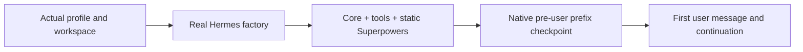
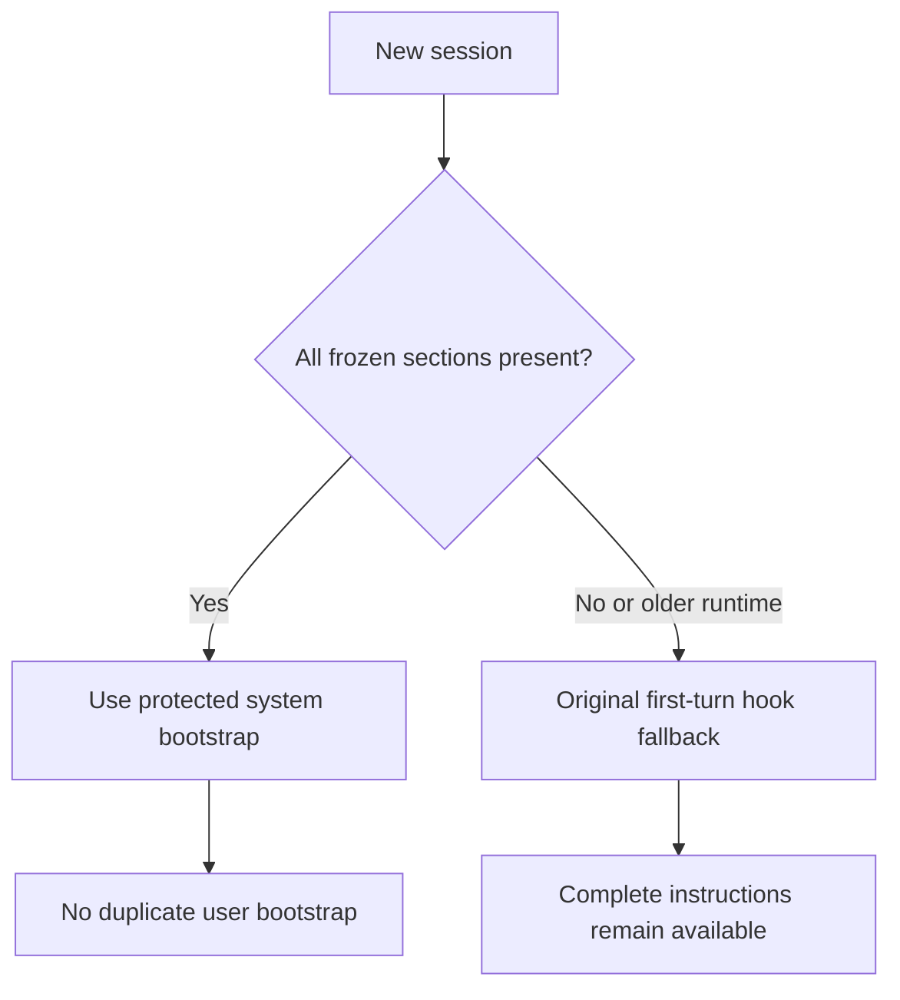
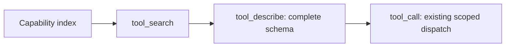

# Hermes: a reusable prefix with the real agent instructions

Keep the fixed Superpowers bootstrap in Hermes's frozen system context, expose
capabilities through an optional concise index, and capture the **actual** first
request before building a native pre-user checkpoint. Skills stay available on
demand. Live conversations retain their original messages and approval flow.

| Component | Purpose | Requirement |
| --- | --- | --- |
| [`superpowers_adapter.py`](superpowers_adapter.py) | Registers the unchanged upstream bootstrap as bounded native prompt sections; keeps the original hook as fallback. | Installed upstream Superpowers skills; Hermes native section API for the cached path. |
| [`pre-llm-system-prompt.patch`](patches/pre-llm-system-prompt.patch) | Three additive lines pass the actual rendered system prompt to `pre_llm_call`, so the adapter can detect missing sections. | Compatible modular Hermes checkout. |
| [`progressive-capability-catalog.patch`](patches/progressive-capability-catalog.patch) | Optional four-line capability cards; complete schemas remain behind native discovery. | Hermes native `tool_search`, `tool_describe`, `tool_call` and skill loader. |
| [`capture_request.py`](capture_request.py) | Captures a normal Web/TUI request through the real agent factory using a fake model transport and disposable persistence. | Installed Hermes dependencies and the matching runtime environment. |
| [`validate_captures.py`](validate_captures.py) | Checks that different first messages produce the same protected system/tools material. | Python3.10+; no model or GPU. |

## How the pieces fit



The checkpoint stops **before any user message**, including a greeting. It stores
the rendered native token prefix and its compatible KV/recurrent state. A JSON
hash or a hand-written prompt is insufficient to prove native token identity.
Model/build/tokenizer/template/cache-geometry changes must be handled by the
native archive's invalidation checks. This integration does not replace those
checks or add another unbounded cache.

## Apply the small hook change

The primary patch was tested against Hermes source revision
[`81805a97ef977b4e1918c0d9945cf720df9952d9`](https://github.com/NousResearch/hermes-agent/tree/81805a97ef977b4e1918c0d9945cf720df9952d9).
It adds an optional helper argument, forwards the actual system prompt to the
hook, and supplies that argument from turn assembly. It does not move arbitrary
hook output into the system prompt. Native prompt sections already exist in
that baseline; this is a local integration patch, not a claim of an upstream
merge or a reason to downgrade a newer working checkout.

From this repository, set `HERMES_SOURCE` to the intended Hermes checkout:

```sh
git -C "$HERMES_SOURCE" apply --check \
  "$PWD/integrations/hermes/patches/pre-llm-system-prompt.patch"
git -C "$HERMES_SOURCE" apply \
  "$PWD/integrations/hermes/patches/pre-llm-system-prompt.patch"
```

Review before applying. If the field is already forwarded upstream, skip this
patch. If a version uses the older monolithic turn builder, the separate
[`pre-llm-system-prompt-legacy.patch`](patches/pre-llm-system-prompt-legacy.patch)
shows its single additive line: `system_prompt=active_system_prompt` at the
`pre_llm_call` invocation, after the live prompt has been restored or built.
Apply only the variant matching the source structure. A failed `--check` requires
review; do not force it or replace whole files across Hermes versions.

Install Superpowers through its own project, then replace only its Hermes
entrypoint with this adapter, retaining its manifest and complete `skills/`
tree. `SUPERPOWERS_PLUGIN` below is the installed Hermes plugin directory:

```sh
cp integrations/hermes/superpowers_adapter.py "$SUPERPOWERS_PLUGIN/__init__.py"
```

The adapter supports the flattened layout and upstream `.hermes-plugin/` layout.
It reads the upstream `using-superpowers/SKILL.md` and tool mapping when the
plugin loads. No skill content is vendored here. Its bootstrap builder and
directory/frontmatter helpers preserve the pinned upstream implementation;
[`provenance.json`](provenance.json) records the source and verification.



The adapter splits only at text boundaries, joining the sections reproduces
every original bootstrap character, and every installed skill is registered.
Missing native APIs, skipped sections, section-budget exhaustion and older
resumed prompts retain the complete first-turn fallback. Existing persisted
prompts are not rewritten. Until a new or resumed session has the compatible
prefix, it may still require ordinary prompt processing.

## Optional progressive capability cards

Apply `patches/progressive-capability-catalog.patch` separately with the same
`git apply --check` workflow. Its default remains `compact`; opt in per profile:

```yaml
tools:
  tool_search:
    listing_style: capabilities
```

Each card has four lines: purpose, when to select the source, input hints, and
exact names. Known built-in browser/board groups have generic guidance; other
groups derive their hints deterministically from scoped tool metadata. No LLM
summarization, profile-specific connector index or policy is included. Budget
overflow uses Hermes's existing compact/name/group fallbacks.



This patch does not disable toolsets, change grants, bypass approvals, or replace
the native skill loader. It also does not automatically defer every tool. If
adding to `tools.tool_search.defer`, **merge** with an existing explicit list;
replacing that list can unexpectedly expose or hide schemas. Retain essential
core tools, use the established browser/board or connector groups as appropriate,
and verify actual discovery and dispatch for the chosen profile. The regression
test exercises search→describe→call and denial outside the session's grants.

## Capture the real pipeline before prewarming

Run captures in fresh processes in the same image/environment, working directory,
profile and tool configuration as the intended normal Web/TUI session. The tool
uses `_make_agent` and a full real turn, then intercepts the final SDK HTTP body
with `httpx.MockTransport`. The configured model/provider/URL remain unchanged.
The response is synthetic `OK`; no inference, tool execution or chat delivery
takes place. It clears dispatcher-only Kanban environment context, without
removing generic board capabilities from the registry.

`HERMES_HOME` alone is insufficient with a temporary DB: Hermes may derive the
agent's profile from that DB's parent. The script explicitly binds the real home
using `set_hermes_home_override` through construction and execution, verifies
`_agent_home`, and checks rendered SOUL and enabled memory/user blocks against
the final system. The session DB and async ledger remain disposable; do **not**
set `_persist_disabled`, which also skips pre-LLM hooks.

Set `INTEGRATION_DIR` to this directory and `CAPTURE_DIR` to a private output
directory outside the repository. From the actual Hermes workspace:

```sh
python3 "$INTEGRATION_DIR/capture_request.py" --repo "$HERMES_SOURCE" \
  --output "$CAPTURE_DIR/first.json" --metadata "$CAPTURE_DIR/first-metadata.json" \
  --user-message 'First controlled message; do not use tools.' \
  --required-system-marker 'superpowers:using-superpowers bootstrap for hermes'
python3 "$INTEGRATION_DIR/capture_request.py" --repo "$HERMES_SOURCE" \
  --output "$CAPTURE_DIR/second.json" --metadata "$CAPTURE_DIR/second-metadata.json" \
  --user-message 'Different controlled message; do not use tools.' \
  --required-system-marker 'superpowers:using-superpowers bootstrap for hermes'
python3 "$INTEGRATION_DIR/validate_captures.py" \
  "$CAPTURE_DIR/first.json" "$CAPTURE_DIR/second.json" \
  --required-system-marker 'superpowers:using-superpowers bootstrap for hermes'
```

Outputs are private0600 files and creation is exclusive. Captures can contain
real profile instructions or memories: **never publish or commit them**. Headers
and credentials are not saved. Core/plugin hashes, actual source-file hashes,
tool names and profile-binding evidence accompany the private captures.

The script blocks socket connections, shell/tool dispatch and non-temporary DB
opens. Only exact inspected read-only metadata probes may spawn. It suppresses
fake-turn debug/session artifact exports on that agent instance while retaining
normal hook/persistence semantics. MCP registration uses native cached schemas,
filters, trust metadata and provenance; it never launches an MCP server. A stale
schema cache normally stops capture. The explicit TTL0 inspection option requires
matching connection fingerprints, an independently supplied live-restart boundary,
and an independently confirmed tool count; it does not enable caching at runtime.

After validation, hand the **original captured request** to the native archive's
pre-user preparation path. Render with the actual model's native template and
tokenizer, prove its protected tokens are a prefix of the untouched real request,
prefill without retaining any user token, and save/restore through the native
state API. Verify reuse with two different real first-user continuations. Failed
or invalid cache preparation must leave ordinary inference available and preserve
more advanced live conversation state. Recreate only the selected invalid base;
do not erase another valid base or overwrite a hot conversation just to prewarm.

For Telegram or another gateway, use that surface's actual constructor/runtime
resolver and context binding instead of assuming the Web factory's toolset,
reasoning or context settings apply. The plugin/hook protocol is shared; the
provided capture executable deliberately targets normal Web/TUI sessions.

## CPU tests

Portable synthetic tests, without Hermes/GPU:

```sh
python3 -m unittest discover -s integrations/hermes/tests -p 'test_*.py' -v
```

HTTPX/OpenAI tests run when those optional dependencies are installed. To also
exercise the real factory with two synthetic sessions/captures, use the patched
Hermes environment and set `HERMES_SOURCE`:

```sh
HERMES_SOURCE="$HERMES_SOURCE" python3 -m unittest discover \
  -s integrations/hermes/tests -p 'test_*.py' -v
PYTHONPATH="$HERMES_SOURCE" python3 -m pytest \
  integrations/hermes/tests/test_catalog_runtime.py -q
```

The last command requires the optional catalog patch and pytest. These tests
prove integration behavior, complete instructions/fallback, profile fidelity,
stable first-request material, privacy guards and scoped discovery. They do not
benchmark native GPU checkpoint correctness or promise a fixed context reduction;
see the repository's [runtime validation and limits](../../README.md).
